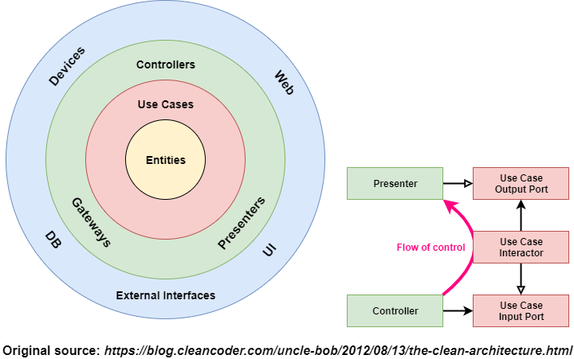
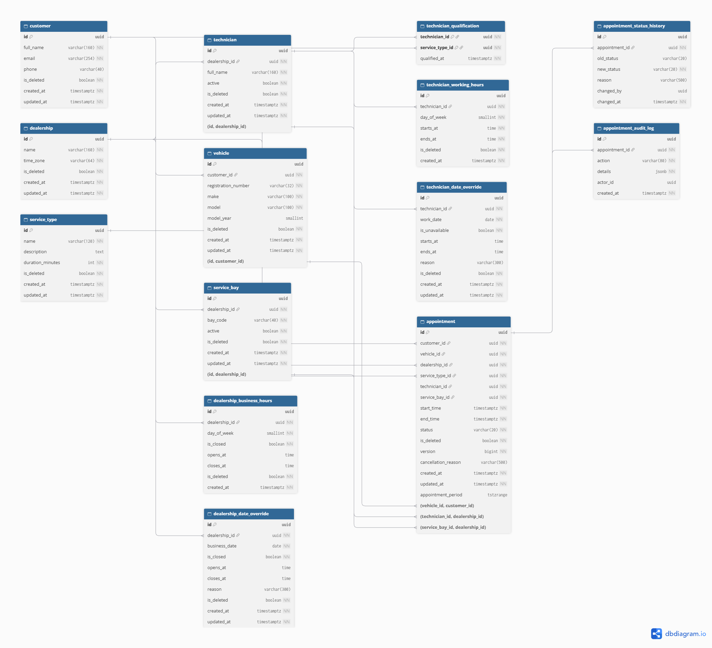

# Keyloop Service Scheduler


A backend appointment scheduling system built with Java and Spring Boot to help automotive dealerships manage service appointments, technicians, and service bays.

The system aims to replace manual booking processes with automated resource availability checking and appointment management.

## Tech Stack

- **Backend:** Java 21, Spring Boot
- **Database:** PostgreSQL
- **ORM:** Spring Data JPA / Hibernate
- **Architecture:** Clean Architecture
- **Build Tool:** Maven
- **Testing:** JUnit 5, Mockito, JaCoCo
- **API Documentation:** Swagger / OpenAPI
- **Infrastructure:** Docker, Azure
- **CI/CD:** GitHub Actions, Azure Pipelines

## Core Features

- Dealership management
- Service management
- Customer and vehicle management
- Appointment booking
- Technician qualification validation
- ServiceBay availability checking
- Transactional resource booking
- Appointment cancellation and status management

## Core Requirements

### 1. Resource-Constrained Booking

Allow customers to book a service appointment for a specific vehicle, service type, dealership, and preferred time.

### 2. Real-Time Availability Checking

Before confirming an appointment, validate the availability of both:

- A suitable ServiceBay.
- A qualified Technician.

Both resources must be available for the entire service duration.

### 3. Confirmed Appointment Record

After successful validation, create a persistent appointment record associating the customer, vehicle, dealership, technician, and service bay.

## API Endpoints

| Method | Endpoint | Description | Status |
| ------ | -------- | ----------- | ------ |
| GET | `/api/v1/dealerships` | List all dealerships | ✅ Completed |
| GET | `/api/v1/services` | List available services | Planned |
| GET | `/api/v1/customers/{id}/vehicles` | List customer's vehicles | Planned |
| POST | `/api/v1/appointments` | Create an appointment | Planned |
| GET | `/api/v1/appointments/{id}` | Get appointment details | Planned |

**Note:** Availability checking is handled internally during appointment creation. A separate availability endpoint may be introduced later if the frontend needs to display available time slots.

## Architecture

The project follows Clean Architecture to separate business logic, application use cases, persistence, and external concerns.

### Clean Architecture



### Database Entity Relationship Diagram



### Architecture Layers

1. **Domain Layer** – Core entities, business rules, and domain logic.
2. **Application Layer** – Use cases, business workflows, and interfaces.
3. **Infrastructure Layer** – External integrations and infrastructure services.
4. **Persistence Layer** – Database access, JPA repositories, and entity mappings.
5. **Presentation Layer** – REST controllers, request/response DTOs, and API configuration.

For more details, see [System Design](docs/system-design.md).

## Prerequisites

Make sure you have installed:

- JDK 21
- Docker Desktop
- Git

## Running Locally

### 1. Clone the repository

```bash
git clone https://github.com/truonghuy2490/keyloop-service-scheduler-demo.git
cd keyloop-service-scheduler-demo
```

### 2. Start PostgreSQL

Start the database using Docker Compose:

```bash
docker compose up -d
```

### 3. Configure Environment Variables

Configure the database connection settings according to your local environment.

Example:

```env
DB_URL=jdbc:postgresql://localhost:5432/keyloop_scheduler
DB_USERNAME=postgres
DB_PASSWORD=your_password
```

### 4. Run Database Migrations

Run the configured database migration process before starting the application.

### 5. Start the Application

Navigate to the backend directory:

```bash
cd backend
```

Run the application:

```bash
./mvnw spring-boot:run
```

On Windows:

```powershell
.\mvnw.cmd spring-boot:run
```

## Testing

Run the test suite and Maven verification:

```bash
./mvnw verify
```

The project uses JUnit 5 and Mockito for testing, with JaCoCo for code coverage measurement.

## API Documentation

Swagger UI and OpenAPI documentation are available when the application is running.

## CI/CD Pipeline

The project uses GitHub Actions and Azure Pipelines.

### GitHub Actions – Backend CI

- Set up Java 21.
- Build the Spring Boot application.
- Run unit tests.
- Verify code coverage with JaCoCo.
- Publish test and coverage reports.

### Azure Pipelines – Build & Deployment Simulation

- Build and test the backend.
- Package the Spring Boot executable JAR.
- Publish the backend artifact.
- Simulate Azure App Service resource creation and application deployment.

**Note:** The current Azure deployment stage is a simulation. It does not create or deploy actual Azure resources.

## AI Collaboration

AI tools are used to support development activities, including:

- Technical research and problem analysis.
- Code review and implementation suggestions.
- Unit test case generation.
- Documentation assistance.

See [AI Collaboration Narrative](docs/ai-collaboration.md).

## License

This project is developed for learning and technical demonstration purposes.